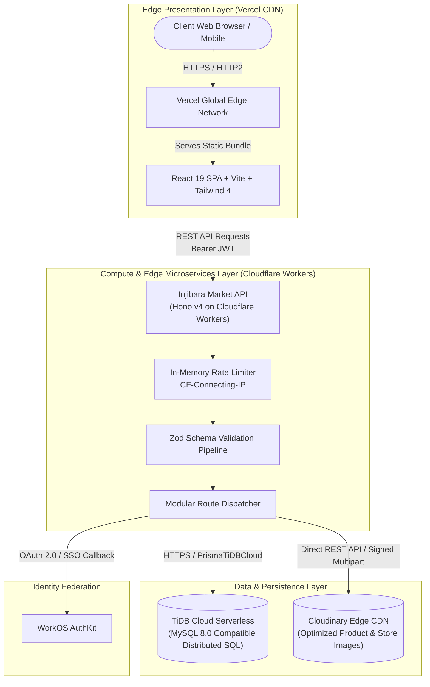
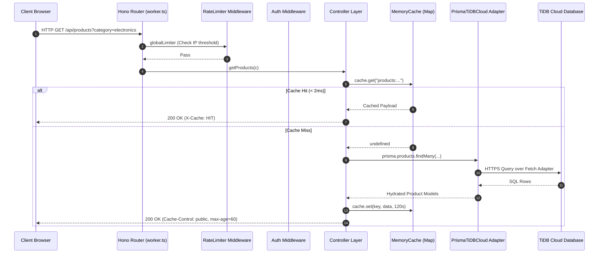
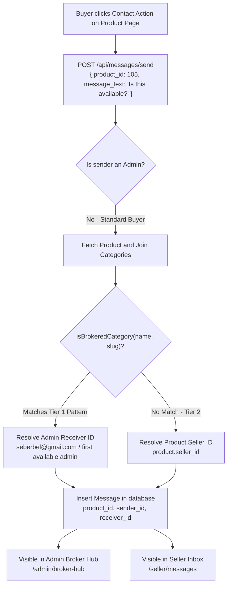

# Injibara Market — Master Technical Architecture

## 1. Global System Topology & High-Level Architecture

Injibara Market utilizes a distributed, serverless cloud architecture specifically optimized for high availability, zero idle costs, sub-second latency across East Africa, and cold-start resilience.

---

## 2. Distributed Runtime Topology

### Component Summary

| Component | Technology | Hosting Platform | URL / Endpoint |
| :--- | :--- | :--- | :--- |
| **Frontend Web App** | React 19, TypeScript, Vite, Tailwind CSS 4 | Vercel Global Edge CDN | `https://injibara-market.vercel.app` |
| **Backend REST API** | Hono v4, TypeScript, Wrangler | Cloudflare Workers | `https://injibara-market-api.inji-mark.workers.dev/api` |
| **Relational Database** | Distributed MySQL 8.0, Prisma ORM | TiDB Cloud Serverless (AWS eu-central-1) | Dedicated Serverless Gateway |
| **Media & Asset Storage** | REST API, Image Transformations | Cloudinary | `res.cloudinary.com/injibara-market` |
| **Identity Federation** | WorkOS Node SDK, OAuth 2.0 | WorkOS Cloud | `https://api.workos.com` |

---

## 3. Backend Architecture Matrix (Server)

The backend runs entirely within Cloudflare Workers isolates using the ultra-fast **[Hono v4](https://hono.dev)** framework, avoiding heavy Node.js server overhead and delivering global millisecond cold-starts.

### Core Server Modules (`server/src/`)

#### 1. Entry Point & Global App Router (`worker.ts`)
* Configures CORS across all incoming routes.
* Binds the Prisma client instance to `c.set('prisma')` on every request using worker context environment bindings (`c.env.DATABASE_URL`).
* Mounts health endpoints: `/` (API sanity ping) and `/healthz` (deep database ping executing `SELECT 1`).
* Mounts modular sub-routers:
  * `/api/auth` &rarr; `authRoutes.ts`
  * `/api/products` &rarr; `productRoutes.ts`
  * `/api/categories` &rarr; `categoryRoutes.ts`
  * `/api/stores` &rarr; `storeRoutes.ts`
  * `/api/messages` &rarr; `messageRoutes.ts`
  * `/api/admin` &rarr; `adminRoutes.ts`
  * `/api/orders` &rarr; `orderRoutes.ts` (Legacy compatibility router)

#### 2. Edge-Compatible Cryptography (`utils/edgeCrypto.ts`)
* Standard Node `bcrypt` fails on edge isolates due to CPU limits (Error 1102: Worker CPU Exceeded) and native C-bindings.
* Implemented with native WebCrypto API (`crypto.subtle`):
  * **Algorithm:** PBKDF2 with SHA-256 digest.
  * **Work Factor:** 100,000 iterations.
  * **Salt / Key Length:** 16-byte random salt, 32-byte derived key.
  * **Serialization:** `pbkdf2:100000:<saltHex>:<hashHex>`.
  * **Execution Time:** < 2ms CPU execution time.

#### 3. Lightweight Edge JWTs (`utils/generateToken.ts`)
* Utilizes **`jose`** (`SignJWT` / `jwtVerify`) instead of standard Node `jsonwebtoken`.
* Generates HS256 signed tokens with a default 30-day expiration containing `{ id, role, email }`.

#### 4. Serverless Database Handshake (`lib/prisma.ts`)
* Uses `@tidbcloud/prisma-adapter` (`PrismaTiDBCloud`) with a single cached `PrismaClient` instance per isolate.
* Connects seamlessly over HTTPS without persistent socket connection exhaustion.

#### 5. Ephemeral In-Memory TTL Cache (`utils/cache.ts`)
* Avoids cross-continental network hops to AWS Frankfurt on high-frequency read requests.
* Provides a zero-dependency in-memory `MemoryCache` backed by a TypeScript `Map`.
* **Categories TTL:** 300 seconds (5 minutes).
* **Products Catalog TTL:** 120 seconds (2 minutes).
* **Single Product TTL:** 180 seconds (3 minutes).

#### 6. Direct Edge Media Streaming (`lib/cloudinary.ts`)
* Does not save files to disk or memory-heavy stream buffers.
* Parses native Web API `File` objects from `c.req.parseBody({ all: true })`.
* Computes an HMAC-SHA1 signature on the fly and posts multipart payload directly to `https://api.cloudinary.com/v1_1/${cloudName}/image/upload`.

---

## 4. The Two-Tier Message & Inquire Engine

The core operational differentiator of Injibara Market is its dynamic inquiry routing subsystem:

### Regex Classification Rules (`utils/brokeredCategories.ts`)
Matches against both English and Amharic keywords:
* **Property & Land:** `property`, `land`, `real-estate`, `farmland`, `plot`, `መሬት`, `ቤት`.
* **Vehicles & Transport:** `vehicle`, `car`, `bajaj`, `motorcycle`, `truck`, `automobile`, `ባጃጅ`, `መኪና`.
* **Heavy Machinery:** `machinery`, `construction`, `tractor`, `excavator`, `bulldozer`, `ማሽነሪ`.

---

## 5. Frontend Architecture Matrix (Client)

The frontend is built on **React 19**, **React Router v7**, and **Tailwind CSS v4** bundled via **Vite**.

```mermaid
graph TD
    App["App.tsx<br/>Theme Context + Router"] --> AppRoutes["AppRoutes.tsx<br/>Route-Level Code Splitting"]

    subgraph PublicRoutes["Public Layer"]
        AppRoutes --> Home["HomePage (Eagerly Loaded)"]
        AppRoutes --> Products["ProductsPage (Lazy)"]
        AppRoutes --> Detail["ProductDetailPage (Lazy)"]
        AppRoutes --> Login["LoginPage / RegisterPage"]
        AppRoutes --> Callback["AuthCallbackPage (WorkOS)"]
    end

    subgraph CustomerRoutes["Authenticated Customer Portal"]
        AppRoutes --> CustDash["CustomerDashboardPage"]
        AppRoutes --> CustMsg["CustomerMessagesPage"]
        AppRoutes --> CustSaved["CustomerSavedPage"]
        AppRoutes --> BecomeSeller["BecomeSellerPage"]
    end

    subgraph SellerRoutes["Seller Management Portal"]
        AppRoutes --> SellerDash["SellerDashboardPage"]
        AppRoutes --> AddProd["AddProductPage"]
        AppRoutes --> EditProd["EditProductPage"]
        AppRoutes --> SellerProd["SellerProductsPage"]
        AppRoutes --> SellerMsg["SellerMessagesPage"]
    end

    subgraph AdminRoutes["Protected Admin Desk"]
        AppRoutes --> AdminLayout["AdminLayout (Sidebar + Guard)"]
        AdminLayout --> AdminDash["AdminDashboardPage"]
        AdminLayout --> BrokerHub["BrokerHubPage (Deduplicated Deals)"]
        AdminLayout --> ModProd["AdminProductsPage"]
        AdminLayout --> ModStore["AdminStoresPage"]
        AdminLayout --> ModCat["AdminCategoriesPage"]
        AdminLayout --> ModUser["AdminUsersPage"]
        AdminLayout --> StaffMgmt["AdminManagementPage"]
    end
```

### Key Frontend Paradigms

#### 1. Code Splitting & Chunk Optimization
Except for `HomePage.tsx` (which is eagerly loaded for instant First Contentful Paint), all major application pages are wrapped in `React.lazy()` dynamic imports. This reduces the initial JavaScript payload from ~600 KB to ~130 KB, ensuring smooth mobile loading across 3G/4G connections in Injibara.

#### 2. Centralized Axios Engine & Cold-Start Interceptor (`api/axiosClient.ts`)
* **Environment-Aware Base URL:**
  * In production builds, routes directly to the Cloudflare Worker URL (`https://injibara-market-api.inji-mark.workers.dev/api`).
  * In local development, falls back to `http://localhost:5000/api` or `VITE_API_BASE_URL`.
* **Automatic Cold-Start Retry:**
  * Automatically catches network timeouts or 502/503/504 gateway errors on idempotent `GET` requests and retries up to 2 times with exponential backoff.
* **Token Injection & Throttled Alerts:**
  * Injects `Authorization: Bearer <token>` from `localStorage`.
  * Suppresses duplicate toast notifications within a 5-second window to prevent notification spamming.

#### 3. Client Storage Protocols
* **Authentication Storage (`utils/authStorage.ts`):**
  * `injibara_market_token`: JWT string.
  * `injibara_market_user`: JSON representation of `{ id, full_name, email, role }`.
* **Saved Products Storage (`utils/savedStorage.ts`):**
  * `injibara_market_saved_products`: JSON array of saved products stored entirely in browser `localStorage`. Dispatches a custom DOM event (`saved_products_updated`) to synchronize bookmark icons across the navbar and product cards in real time without network requests.

---

## 6. Security, Identity Federation & RBAC

### 1. Multi-Tier Rate Limiting (`middleware/rateLimiter.ts`)
Tracks request volumes using an in-memory sliding window keyed by client IP (`CF-Connecting-IP` / `x-forwarded-for`):
* **Global Rate Limit:** 300 requests / 15 minutes.
* **Authentication Limit:** 10 requests / 15 minutes (protects `/login` and `/register` from brute-force attempts).
* **Creation Limit:** 25 requests / 15 minutes (protects `/messages/send` and `/products` from spam listings).

### 2. WorkOS AuthKit Federation (`controllers/workosAuthController.ts`)
Enables enterprise SSO, passwordless magic links, and Google OAuth:
1. Client requests an authorization URL: `GET /api/auth/workos/url`.
2. User authenticates on the WorkOS hosted screen.
3. User is redirected back to `/auth/callback?code=...`.
4. Client sends code to `POST /api/auth/workos/callback`.
5. Worker verifies code, upserts user record in TiDB, and returns a session JWT.

### 3. Role-Based Access Control (RBAC)
* **`customer`:** Can view catalog, post inquiries, save items locally, and create products (which triggers automatic role upgrade to `seller`).
* **`seller`:** Can manage their own product listings (`/api/products/my-products`), view inbound customer messages, and create/update their store profile.
* **`admin`:** Full administrative access to product approval/rejection, user suspensions, category creation, and the Broker Hub.
* **`admin_permissions` Delegation:** Fine-grained permissions (`overview`, `broker_hub`, `products`, `stores`, `categories`, `users`, `admin_management`, `settings`) can be granted to individual administrator accounts.

---

## 7. Data Layer: Active vs. Legacy Schema Architecture

### Active Production Models
* **`users`:** Customer, seller, and admin accounts. Stores credentials, contact phone, role, and suspension state (`deleted_at`).
* **`products`:** Marketplace listings with title, description, price, discount price, category relation, and status (`draft`, `pending`, `approved`, `rejected`, `inactive`, `archived`).
* **`product_images`:** Multi-image gallery per product with Cloudinary URLs and ordering.
* **`categories`:** Hierarchical marketplace categories with bilingual names, slugs, and descriptions.
* **`stores`:** Dedicated seller storefront profiles with logos and kebele locations.
* **`messages`:** In-app communication records linking sender, receiver, and referenced product ID.
* **`broker_inquiries`:** Broker deal records tracking `status` (`NEW`, `ASSIGNED`, `APPOINTMENT_SCHEDULED`, `DEAL_CLOSED`), appointment dates, and admin notes.
* **`admin_permissions`:** Granular feature permissions allocated to staff admins.

### Legacy / Inactive Schema Models
The Prisma schema includes several models from earlier development iterations that are **not active in the current business model**:
* `carts` & `cart_items`: Bypassed by the direct inquiry and broker workflows.
* `orders`, `order_items`, & `order_status_history`: Bypassed in favor of in-person negotiation and offline cash/escrow settlement.
* `payments`: Bypassed by offline cash settlements and direct P2P mobile transfers.
* `addresses`: Bypassed in favor of informal landmark-based meetups.
* `reviews`: Reserved for future product ratings post-launch.
