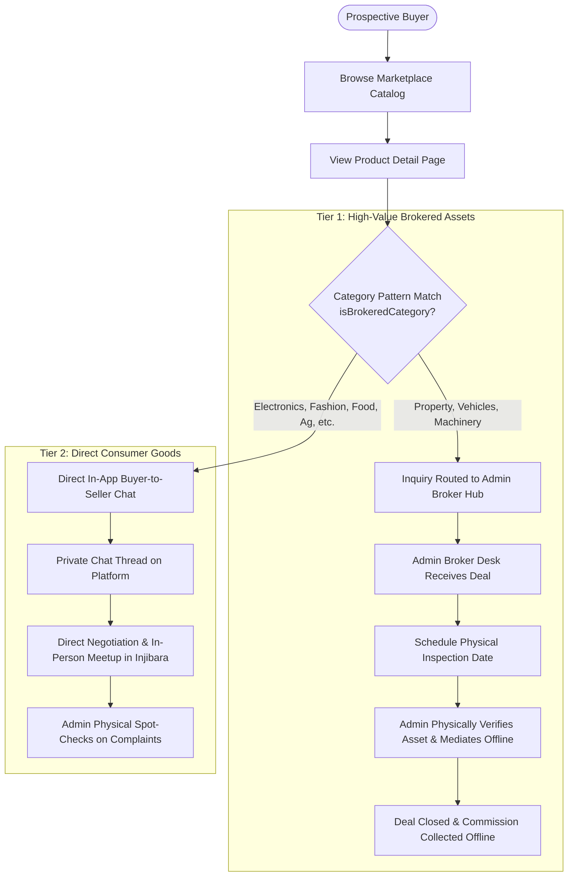
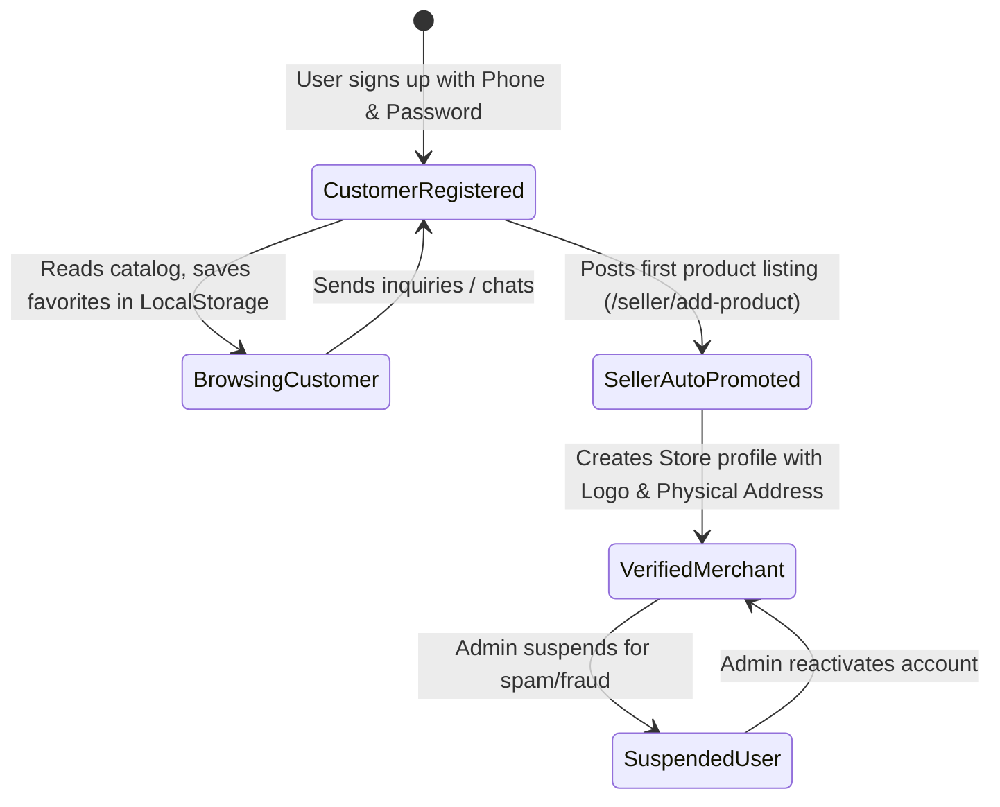

# Injibara Market (እንጂባራ ገበያ) — Business Model & Domain Architecture

## 1. Executive Summary & Regional Context

**Injibara Market** is a hyper-localized digital commerce and brokered trading platform engineered specifically for **Injibara city** and the surrounding **Awi Administrative Zone** in the Amhara Region of Ethiopia.

Injibara serves as a vital economic crossroads connecting Gojjam with western Ethiopia. The local economy thrives on active trade in agricultural staples (particularly high-grade red and white Teff), livestock, commercial transport (Bajaj, Isuzu trucks, minibuses), real estate, construction machinery, and retail commodities.

Despite high economic turnover, local commerce has historically faced critical structural bottlenecks:
1. **The Regional Trust & Verification Deficit:** High-value capital transactions (land plots, agricultural machinery, vehicles) cannot safely transact through anonymous peer-to-peer classifieds due to title deed disputes, counterfeit documents, and lack of legal recourse.
2. **Offline Discovery Inefficiencies:** Local retail shops, artisans, and farmers lack a unified regional catalog, forcing buyers to physically comb the open market (ገበያ) on market days to compare prices and check availability.
3. **Financial Friction in Rural eCommerce:** Pure automated online checkouts (credit cards, automated escrow gateways) fail in regional Ethiopia due to cash dominance, irregular network connectivity, and reluctance to transfer large sums to unverified third parties without physical inspection.

To overcome these realities, Injibara Market implements a **Two-Tier Brokered System** combining high-velocity digital discovery with physical, on-the-ground administrative mediation.

---

## 2. The Two-Tier Operational Model

The platform programmatically partitions all products and economic activity into two distinct operational tiers based on asset value and legal verification requirements.

---

### Tier 1: High-Capital Brokered Assets

#### Eligible Categories
* **Property & Land (ቤት እና መሬት):** Residential homes, commercial properties, plots, agricultural farmland, rental compounds.
* **Vehicles & Transport (መኪኖች እና ባጃጅ):** Bajaj (three-wheelers), passenger cars, commercial transport trucks (e.g., Isuzu), motorcycles, tractors.
* **Heavy Machinery & Equipment (ማሽነሪ):** Agricultural harvesters, construction machinery, grain mills, industrial equipment.

#### Mechanics & The Admin Broker Hub
1. **Inquiry Interception:** In Tier 1 listings, buyers cannot message the seller directly. When a buyer clicks *"Contact Admin / Inquire"*, the message routing engine (`resolveProductReceiver`) automatically intercepts the inquiry and routes it to the **Admin Broker Desk** (`/admin/broker-hub`).
2. **Lead Deduplication:** The backend deduplicates inquiries by unique `(product_id, buyer_id)` pairs, maintaining a clean deal dossier for every transaction.
3. **Broker Hub State Machine:**
   * `NEW`: Fresh buyer inquiry requiring administrator triage.
   * `ASSIGNED`: In-app dialogue opened between administrator and prospective buyer.
   * `CONTACTED`: Administrator has contacted both the buyer and seller.
   * `APPOINTMENT_SCHEDULED`: Official physical inspection date and time recorded in the system.
   * `IN_PROGRESS`: Site visit, legal documentation inspection, and price negotiation underway.
   * `DEAL_CLOSED`: Transaction successfully executed offline.
   * `CANCELLED` / `REJECTED`: Deal aborted or listing disqualified.
4. **Physical On-Site Verification:**
   * The platform administrator or local field agent physically travels to inspect the land parcel, test-drive the vehicle, or inspect the machinery.
   * The admin verifies Kebele documentation, land lease certificates, or vehicle ownership logbooks (*Libre*) to ensure legal clear title.
   * The admin mediates the final price negotiation between buyer and seller in person.

---

### Tier 2: Direct Peer-to-Peer Marketplace

#### Eligible Categories
* **Agriculture & Teff (ግብርና እና ጤፍ):** Teff grains, seeds, organic fertilizer, farm produce.
* **Livestock & Animals (የከብት እርባታ):** Cattle, oxen, sheep, goats, poultry.
* **Electronics & Phones (ኤሌክትሮኒክስ):** Mobile phones, laptops, solar systems, televisions, accessories.
* **Fashion & Clothes (አልባሳት እና ጫማዎች):** Modern wear, traditional Ethiopian clothing, shoes.
* **Food & Groceries (ምግብ እና የሸቀጥ እቃዎች):** Butter (*Qibe*), spices (*Berbere*), honey, cooking oil, packaged staples.
* **Home & Living (የቤት እና የቢሮ እቃዎች):** Furniture, kitchenware, bedding.
* **Health, Beauty & Services (ውበት፣ ጤና እና አገልግሎቶች):** Personal care products, local artisan handicrafts, repair services.

#### Mechanics & Peer-to-Peer Workflows
1. **Direct Communication:** The buyer clicks *"Contact Seller"* on the product page. This initializes a private, real-time message thread linked directly to the product ID (`/messages/chat/:productId`).
2. **Localized Meetup:** Buyers and sellers coordinate an in-person exchange at a well-known Injibara landmark (e.g., Injibara Central Market, Stadium area, or the seller's storefront).
3. **Physical Inspection & Cash Settlement:** The buyer inspects the goods on-site and settles payment directly in cash or peer-to-peer Telebirr/CBE transfer.
4. **Trust & Safety Spot-Checks:** Platform administrators conduct periodic physical spot-checks of registered merchant locations to confirm legitimate business operations.

---

## 3. Merchant & User Lifecycle

### 1. Frictionless Registration & Auto-Promotion
* **Low Barrier to Entry:** To stimulate catalog growth in an emerging market, registration requires only a name, email/phone, and password.
* **Dynamic Role Escalation:** Customers do not need to fill out lengthy administrative forms before posting goods. The moment a user publishes their first product via `POST /api/products`, the backend automatically elevates their role from `customer` to `seller`.
* **Storefront Management:** Sellers can optionally create dedicated Store profiles (`/api/stores`) with store logos, descriptions, phone numbers, and physical kebele addresses.

### 2. Administrative Hierarchy & Governance
* **Super Admin / Platform Owners:** Full access to staff admin creation, role assignments, system-wide moderation, and permission delegation (`admin_permissions` table).
* **Operational Admin / Broker Agents:** Assigned granular permissions (`broker_hub`, `products`, `stores`, `categories`, `users`) to manage listings, respond to Tier 1 deal inquiries, schedule appointments, and perform physical inspections.

---

## 4. Monetization Strategy

Injibara Market follows a phased commercial rollout designed to first build network liquidity before activating monetization streams.

| Commercial Phase | Timeline | Revenue Stream | Execution Mechanics |
| :--- | :--- | :--- | :--- |
| **Phase 1: Market Seeding** | Months 0 – 6 | **100% Free Public Utility** | Zero listing fees, zero broker commissions, zero subscription barriers. Primary KPI is catalog depth and weekly active traders in Injibara. |
| **Phase 2: Commercial Activation** | Month 6 onwards | **1. Tier 1 Brokerage Commissions** | Admin team collects a success-based brokerage commission (typically 2% – 5%) directly from the seller upon offline closing of high-value deals. |
| | | **2. Merchant Listing Fees** | Free tier up to *N* active listings; tiered monthly subscription for commercial wholesalers and high-volume merchants. |
| | | **3. Featured Listing Promotions** | Pay-to-promote fee allowing sellers to boost items to the top hero carousel and priority category ranks. |

---

## 5. Localization & Cultural Adaptation

* **Default Mixed Language (Hybrid Lingua Franca):** In urban and peri-urban Ethiopian commerce, traders naturally speak Amharic while utilizing standard English terminology for product specs, brands, and digital navigation (e.g., *"Electronics"*, *"iPhone"*, *"Bajaj"*). The current default interface embraces this bilingual mix for effortless readability.
* **Full Amharic (አማርኛ) Option:** To serve rural farmers, traditional craftsmen, and elders with limited English proficiency, the platform architecture incorporates a dedicated Amharic translation option enabling 100% localized UI text across all views.
* **Local Currency Mandatory:** All valuations, negotiations, and product listings are strictly denominated in **Ethiopian Birr (ETB)**.
