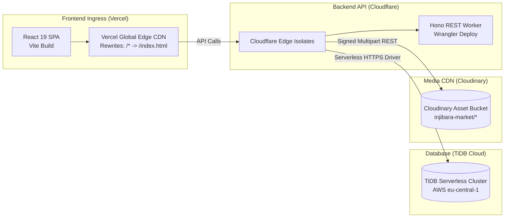
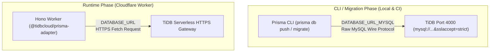

# Injibara Market — Deployment & DevOps Engineering Guide

## 1. Production Topology Overview

Injibara Market utilizes a distributed serverless multi-cloud deployment architecture engineered for zero idle cost, instant global edge routing, and automatic scale.



---

## 2. Cloudflare Workers API Deployment (Backend)

The backend (`server/`) is deployed as a serverless worker on Cloudflare's global edge network.

### Prerequisites
* Cloudflare account with Workers enabled.
* Wrangler CLI installed locally or via devDependencies:
  ```bash
  npm install -g wrangler
  # or use repo-local wrangler
  npx wrangler --version
  ```

### Configuration (`server/wrangler.jsonc`)
```jsonc
{
  "$schema": "../node_modules/wrangler/config-schema.json",
  "name": "injibara-market-api",
  "main": "src/worker.ts",
  "compatibility_date": "2026-08-04",
  "compatibility_flags": ["nodejs_compat"],
  "vars": {
    "ENVIRONMENT": "production"
  }
}
```

### Deployment Commands
From the monorepo root:
```bash
# 1. Build and generate Prisma client
npm run build --workspace=server

# 2. Deploy directly to Cloudflare
npm run deploy:server
```
Or directly within the `server/` directory:
```bash
cd server
npx prisma generate
npx wrangler deploy
```

### Setting Production Worker Secrets
Encrypted secrets must be provisioned directly via Wrangler CLI into Cloudflare's secure keystore:
```bash
npx wrangler secret put DATABASE_URL
# Input: Serverless connection URL for TiDB Cloud

npx wrangler secret put JWT_SECRET
# Input: Cryptographically secure 256-bit string

npx wrangler secret put CLOUDINARY_CLOUD_NAME
npx wrangler secret put CLOUDINARY_API_KEY
npx wrangler secret put CLOUDINARY_API_SECRET

npx wrangler secret put WORKOS_API_KEY
npx wrangler secret put WORKOS_CLIENT_ID
```

---

## 3. TiDB Cloud Serverless Setup (Database)

Injibara Market uses **TiDB Cloud Serverless**, an elastic, auto-scaling, distributed MySQL 8.0-compatible database hosted in AWS Frankfurt (`eu-central-1`).

### The Dual Connection Architecture

Two distinct connection URLs are utilized across the lifecycle:



1. **`DATABASE_URL` (Runtime Worker Adapter):**
   * Consumed by `server/src/lib/prisma.ts` using `@tidbcloud/prisma-adapter`.
   * Operates entirely over HTTPS/Fetch without persistent socket overhead.
   ```env
   DATABASE_URL="https://gateway01.eu-central-1.prod.aws.tidbcloud.com/v1/sql"
   ```
2. **`DATABASE_URL_MYSQL` (Prisma CLI & Schema Migrations):**
   * Consumed by `server/prisma.config.ts` for schema synchronizations and migrations:
   ```env
   DATABASE_URL_MYSQL="mysql://<user>:<password>@gateway01.eu-central-1.prod.aws.tidbcloud.com:4000/injibara_db?sslaccept=strict"
   ```

### Schema Synchronization Commands
```bash
cd server

# Generate the Prisma TypeScript Client
npx prisma generate

# Push Prisma schema directly to TiDB Cloud
npx prisma db push

# (Optional) Seed default bilingual marketplace categories
npx tsx src/utils/seedCategories.ts
```

---

## 4. Vercel SPA Deployment (Frontend)

The frontend (`client/`) is an optimized Single Page Application (SPA) deployed to Vercel's global edge network.

### Build Settings
* **Framework Preset:** Vite
* **Root Directory:** `client` (or monorepo root with `--workspace=client`)
* **Build Command:** `npm run build`
* **Output Directory:** `dist`
* **Node.js Version:** `20.x`

### Edge Routing & SPA Fallback (`vercel.json`)
Both root `vercel.json` and `client/vercel.json` ensure client-side routing routes smoothly back to `index.html`:
```json
{
  "rewrites": [
    {
      "source": "/(.*)",
      "destination": "/index.html"
    }
  ]
}
```

### Production Environment Variables (Vercel Dashboard)
| Variable | Value | Description |
| :--- | :--- | :--- |
| `VITE_API_BASE_URL` | `https://injibara-market-api.inji-mark.workers.dev/api` | Points production traffic to Cloudflare Worker. |

---

## 5. Local Development Environment

### Quickstart with Docker Compose

To guarantee consistent local environments across developer machines, Docker Compose provisions a local MySQL 8.0 instance:

```bash
# 1. Start local MySQL container
docker compose up -d mysql

# 2. Verify MySQL container is healthy
docker compose ps
# injibara-mysql (port 3307 -> 3306)

# 3. Install monorepo dependencies
npm install

# 4. Generate local Prisma client
npm run build --workspace=server

# 5. Run local development services concurrently
npm run dev
# Starts backend on Cloudflare Wrangler (port 8787)
# Starts frontend on Vite (port 5173)
```

---

## 6. Continuous Integration (GitHub Actions)

The repository runs an automated CI/CD pipeline on every pull request and push to `develop` and `main` (`.github/workflows/ci.yml`):

1. **Lint & Format:** Runs `eslint .` across workspaces to enforce strict TypeScript and code style rules.
2. **Automated Vitest Pipeline:**
   * Spins up a temporary `mysql:8.0` container inside the GitHub runner.
   * Runs `npx prisma generate`.
   * Executes backend integration and auth unit tests (`npm test --workspace=server`).
3. **Multi-Workspace Compile Check:** Verifies both `client` (Vite) and `server` (TypeScript) compile to zero warnings/errors.
4. **Docker Validation:** Validates that `api.Dockerfile` builds cleanly without cache corruptions.
